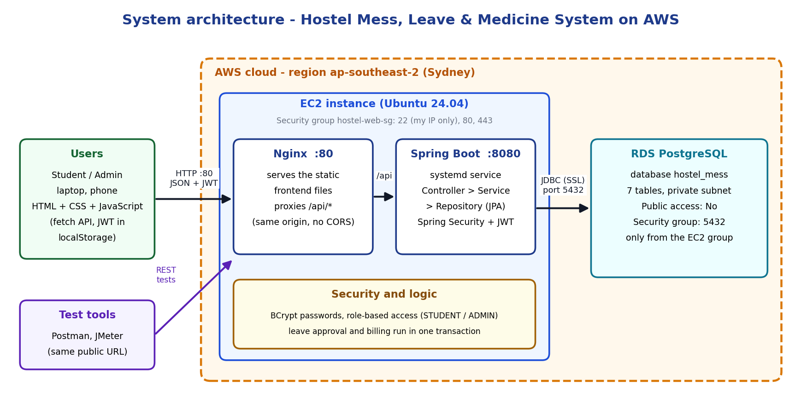
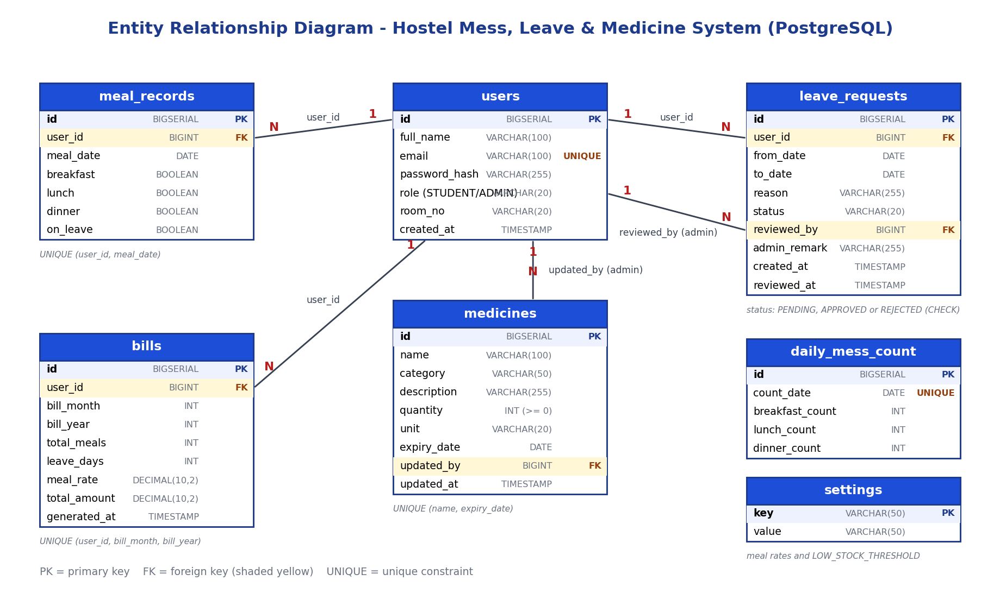

# Cloud-Based Hostel Mess, Leave & Medicine Management System

Cloud Computing Practical, Open-Ended Lab (OEL)

A live, cloud-hosted, multi-user web system. **Students** manage meals, request leave, see their monthly bill and check which medicines the hostel has. **Hostel administrators** manage mess counts, approve or reject leave, generate bills and reports, and maintain the medicine stock. **Approved leave automatically changes the mess count and the monthly bill.**

**Live system:** `http://<13.54.224.116>` (AWS EC2 + RDS, region ap-southeast-2 Sydney). Replace this line with the address you used for the demo.

## Team

| Member | Responsibility |
|---|---|
| Member 1: (Sharjeel Raza / K22SW003) | Database, Authentication and RBAC, AWS deployment, load test |
| Member 2: (Sindhu Sahito / K22SW004) | Frontend, unit tests, Postman collection |
| Member 3: (Saira Abbas / K22SW006) | Medicine module, leave module, billing and approval transaction, documentation |

## Requirements coverage

| Teacher's requirement | How it is met | Evidence |
|---|---|---|
| Two roles with authentication and role-based access | STUDENT and ADMIN, JWT login, BCrypt, Spring Security role rules | Postman 401/403 tests, `RoleAccessTest` |
| Mess/meal management, leave submission, approval/rejection, billing and reporting | Student and admin pages plus REST endpoints | Postman collection, screenshots |
| REST APIs tested with Postman | `docs/postman/` collection with positive and negative tests, Local and Cloud environments | Collection Runner results |
| Centralized PostgreSQL, application and database on AWS | EC2 (backend + frontend) and RDS PostgreSQL in a private subnet | EC2 and RDS console screenshots |
| Approved leave changes mess count and bill automatically | One database transaction on approval (see rule 7 below) | Bill before/after, mess count for a leave day |
| GitHub with README, setup and deployment instructions | This file, `deployment/` scripts | Repository |
| Concurrent requests and 2+ devices | Spring Boot thread pool, JMeter test with 30 and 50 users, laptop and phone demo | JMeter report, `docs/CONCURRENCY-NOTES.md` |
| Not localhost-only | Public URL served by Nginx on EC2 | Screenshot of the live site |

## Technology

| Layer | Choice |
|---|---|
| Frontend | HTML5, CSS3, vanilla JavaScript (Fetch API), multi-page |
| Backend | Java 17, Spring Boot 3.5, Spring Web, Spring Data JPA, Spring Security, Validation, Lombok |
| Authentication | JWT (jjwt), BCrypt |
| Database | PostgreSQL (AWS RDS in production) |
| Cloud | AWS EC2 (Ubuntu 24.04) and RDS |
| Web server | Nginx (serves the frontend and proxies `/api` to the backend) |
| Testing | Postman, JUnit 5, Mockito, Spring MVC Test, Apache JMeter |
| Version control | Git and GitHub |

## Architecture



The browser never talks to the database. Nginx serves the pages and the API from the same origin, so no CORS settings are needed in production. The RDS security group accepts connections only from the EC2 security group.

## Database



Seven tables: `users`, `meal_records`, `leave_requests`, `daily_mess_count`, `bills`, `medicines`, `settings`. The scripts are `database/schema.sql` and `database/seed.sql`.

## Roles

| Feature | STUDENT | ADMIN |
|---|---|---|
| Register and log in | Yes (self-register) | Yes (created by the hostel office) |
| Own meals, leave requests, bills | Yes | No |
| Hostel-wide meals and daily mess count | No | Yes |
| Approve / reject leave | No | Yes |
| Generate bills and monthly report, change rates | No | Yes |
| Search medicines (read-only) | Yes | Yes |
| Add / edit / delete medicines and stock | No | Yes |

## Main business rules

1. Only students can register. Admins are created in the database.
2. Passwords are stored only as BCrypt hashes.
3. A leave request needs `to_date >= from_date`, a start date that is not in the past, and cannot overlap another pending or approved leave of the same student. The maximum length is 90 days.
4. Only a PENDING leave can be approved or rejected.
5. Approving a leave runs in one transaction: the status becomes APPROVED, the student's meals for every date in the range are set to on-leave with no meals, the daily mess counts are recounted, and the bill of every affected month is recalculated.
6. Bill = breakfasts x breakfast rate + lunches x lunch rate + dinners x dinner rate, counting only days that are not on leave. Regenerating a bill updates it. The rates are stored in `settings`.
7. Students cannot add or change meals on leave dates.
8. A medicine is AVAILABLE, LOW_STOCK (at or below the threshold), OUT_OF_STOCK or EXPIRED. The status is calculated, never stored. Quantity cannot be negative.

## REST API

Base path `/api`. Protected routes need the header `Authorization: Bearer <token>`.

| Method | Endpoint | Role | Purpose |
|---|---|---|---|
| POST | `/auth/register` | public | Register a student |
| POST | `/auth/login` | public | Log in, returns JWT, role and user info |
| POST | `/meals` | STUDENT | Add or update own meal record for a date |
| GET | `/meals/my?month=&year=` | STUDENT | Own meal records |
| POST | `/leaves` | STUDENT | Submit a leave request |
| GET | `/leaves/my` | STUDENT | Own leave requests |
| GET | `/bills/my` | STUDENT | Own bills |
| GET | `/medicines?search=&category=&availableOnly=` | STUDENT, ADMIN | Search medicines with computed status |
| GET | `/medicines/categories` | STUDENT, ADMIN | Categories for the filter |
| GET | `/medicines/{id}` | STUDENT, ADMIN | One medicine |
| GET | `/admin/leaves?status=` | ADMIN | List leave requests |
| PUT | `/admin/leaves/{id}/approve` | ADMIN | Approve (runs the transaction above) |
| PUT | `/admin/leaves/{id}/reject` | ADMIN | Reject with optional remark |
| GET | `/admin/mess-count?date=` | ADMIN | Daily mess count |
| GET | `/admin/meals?date=` | ADMIN | All meal records of a date |
| POST | `/admin/bills/generate?month=&year=` | ADMIN | Generate or refresh bills for all students |
| GET | `/admin/bills?month=&year=` | ADMIN | Bills of a month |
| GET | `/admin/reports/monthly?month=&year=` | ADMIN | Monthly report |
| GET / PUT | `/admin/settings/rates` | ADMIN | Read / change meal rates and low-stock threshold |
| POST | `/admin/medicines` | ADMIN | Add a medicine |
| PUT | `/admin/medicines/{id}` | ADMIN | Edit a medicine |
| PUT | `/admin/medicines/{id}/stock` | ADMIN | Update quantity |
| DELETE | `/admin/medicines/{id}` | ADMIN | Delete a medicine |
| GET | `/admin/medicines/alerts` | ADMIN | Low-stock, out-of-stock and expired items |

Errors use one JSON format: `timestamp`, `status`, `message`. Codes: 200, 201, 204, 400, 401, 403, 404, 409.

## Project structure

```
hostel-mess-system/
├── backend/            Spring Boot project (controller, service, repository, model, dto, security, exception)
├── frontend/           HTML pages, css/style.css, js/ (config, api, auth, student, medicines, admin, admin-medicines)
├── database/           schema.sql, seed.sql
├── deployment/         nginx.conf, hostel-backend.service and the server scripts
└── docs/               architecture-diagram.png, erd.png, postman/, loadtest/, screenshots/
```

## Run it on your own computer

You need JDK 17, PostgreSQL, Git and a browser. Maven is included as `mvnw`.

1. Clone the repository.
2. Create the database and load the scripts:
   ```
   psql -U postgres -c "CREATE DATABASE hostel_mess;"
   psql -U postgres -d hostel_mess -f database/schema.sql
   psql -U postgres -d hostel_mess -f database/seed.sql
   ```
3. Set the environment variables (Command Prompt) and start the backend:
   ```
   cd backend
   set DB_URL=jdbc:postgresql://localhost:5432/hostel_mess
   set DB_USERNAME=postgres
   set DB_PASSWORD=<your PostgreSQL password>
   set JWT_SECRET=<a random string of 48 or more characters>
   set JWT_EXPIRATION_MS=86400000
   set CORS_ALLOWED_ORIGIN=http://127.0.0.1:5500
   set PORT=8081
   mvnw.cmd spring-boot:run
   ```
4. `frontend/js/config.js` points to `http://localhost:8081/api`. If you use another port, change that one line.
5. Open `frontend/index.html` with the VS Code **Live Server** extension, at `http://127.0.0.1:5500`.
6. Register a student, or log in with the seeded admin `admin@hostel.local` (the password is given separately in the submission report).

Environment variables used by the backend:

| Variable | Meaning |
|---|---|
| `DB_URL` | JDBC URL of PostgreSQL |
| `DB_USERNAME`, `DB_PASSWORD` | Database credentials |
| `JWT_SECRET` | Signing secret, 32 or more characters |
| `JWT_EXPIRATION_MS` | Token lifetime in milliseconds (default 86400000) |
| `CORS_ALLOWED_ORIGIN` | Frontend origin, needed only for local development |
| `PORT` | Server port (default 8080) |
| `DB_POOL_SIZE` | Database connection pool size (default 10) |

## Cloud deployment (AWS)

**Services used:** EC2 (Ubuntu 24.04, free-tier eligible instance type) for Nginx, the frontend files and the Spring Boot service; RDS PostgreSQL (private, not publicly accessible) for the database. Region: ap-southeast-2 (Sydney).

**Security group rules**

| Group | Direction | Port | Source |
|---|---|---|---|
| `hostel-web-sg` (EC2) | Inbound | 22 | My IP only |
| `hostel-web-sg` (EC2) | Inbound | 80, 443 | Anywhere (HTTPS is not configured) |
| RDS group | Inbound | 5432 | The EC2 security group only |

**Environment variables on the server** are stored in `/etc/hostel-mess/backend.env` (root only, not in the repository). `create-env.sh` creates it with the RDS settings (`sslmode=require`) and a new random JWT secret.

**Build and deploy (from your Windows computer)**
```
deployment\upload-to-aws.bat "%USERPROFILE%\.ssh\hostel-key.pem" <EC2-PUBLIC-IP>
```
It runs `mvnw.cmd clean package -DskipTests` and uploads the JAR, `frontend/`, `deployment/` and `database/` to the server.

**One-time server setup (over ssh)**
```
bash ~/upload/deployment/setup-server.sh     # Java 17, Nginx, service user, Nginx and systemd files
bash ~/upload/deployment/create-env.sh       # database settings and JWT secret
bash ~/upload/deployment/init-database.sh    # schema.sql and seed.sql on RDS
bash ~/upload/deployment/deploy-app.sh       # install the JAR and frontend, start everything
bash ~/upload/deployment/make-admin.sh       # turn a registered account into the admin, remove the development admin
```
**Update after a code change:** run the upload script again, then `bash ~/upload/deployment/deploy-app.sh`.

**How the service is started:** the backend runs as the systemd service `hostel-backend` (starts at boot and restarts on failure). Useful commands: `sudo systemctl status hostel-backend`, `sudo journalctl -u hostel-backend -n 50 --no-pager`. Nginx (`deployment/nginx.conf`) serves `/var/www/hostel-mess` and proxies `/api/` to `127.0.0.1:8080`. The deployed `config.js` uses `/api`, so there is no localhost address in the deployed copy.

**Public URL:** `http://<13.54.224.116>`

## Testing

- **Postman:** import `docs/postman/Hostel-Mess-API.postman_collection.json` and an environment (Local or Cloud). Run the collection in order; folder 0 logs in and saves the tokens. The collection has positive tests and negative tests (401, 403, 400, 409).
- **Unit tests:** `cd backend` then `mvnw.cmd clean test` (38 tests: bill calculation, leave approval, overlap validation, medicine status, meal rules, role restriction).
- **Load test:** `docs/loadtest/` contains a JMeter plan. Run `docs\loadtest\run-loadtest.bat "<JMETER-FOLDER>" <13.54.224.116> 30` (and `50`). Users log in, save a meal for the same date and search medicines at the same time. The report is written to `docs/loadtest/results/`.
- **Concurrency:** see `docs/CONCURRENCY-NOTES.md`.

## Security

- BCrypt password hashes; JWT secret and database credentials only in environment variables.
- Every protected endpoint checks the role; students see only their own records.
- The database is private and reachable only from the EC2 security group.
- The frontend inserts server data with `textContent`, never `innerHTML`.
- `.gitignore` excludes `.env`, `set-env.bat`, `target/` and `*.pem`.

## Screenshots

See `docs/screenshots/`. The list of screenshots to take is in `docs/screenshots/README.md`.
